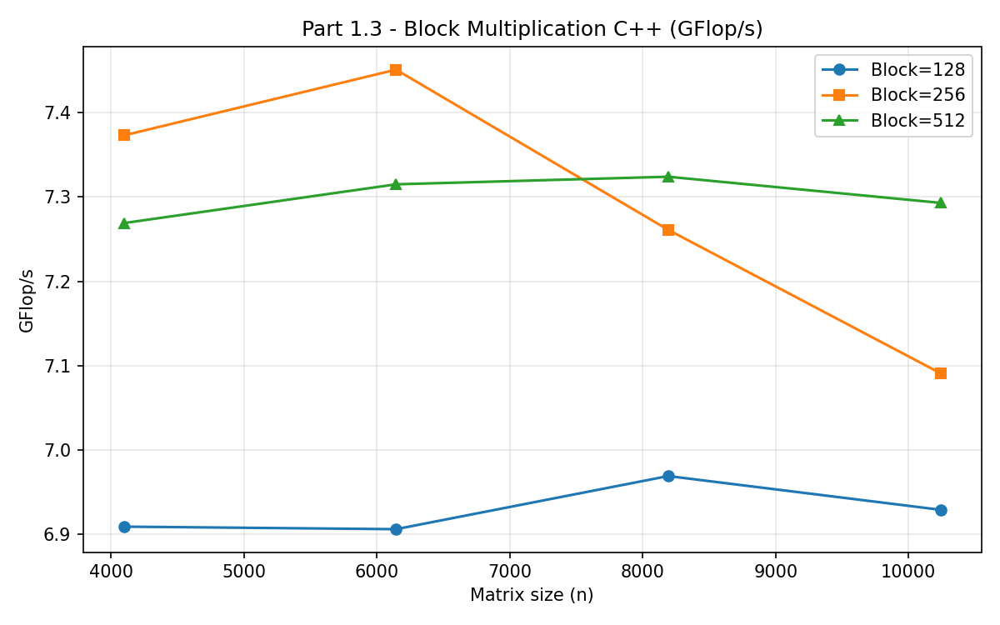
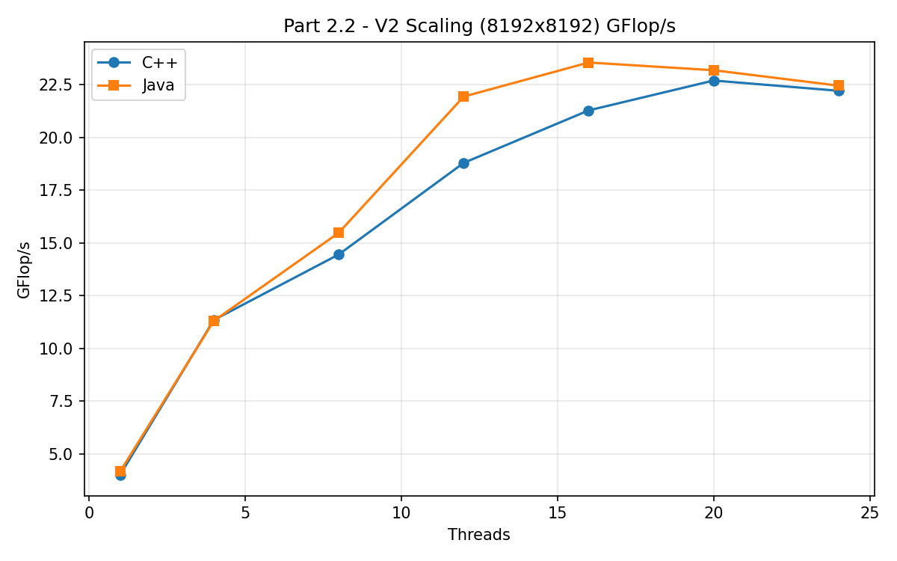

# Matrix Multiplication Performance

A performance study of dense matrix multiplication in **C++** and **Java**, measuring how the memory hierarchy and multi-core parallelism affect throughput (GFlop/s). The study uses hardware performance counters collected with Linux `perf` and compares cache-friendly algorithms and their parallel versions using OpenMP and Java threads.

Built by a team of 3 for the Parallel and Distributed Computing course (L.EIC, FEUP, 2025/26), Assignment 1. Grade: **15.1/20**.

## What was measured

| Algorithm | Idea |
|---|---|
| **Naive (ijk)** | Standard triple loop, column-wise access to B |
| **Line (ikj)** | Reordered loops so B is read row by row (cache-friendly) |
| **Block** | Tiled multiplication with block sizes 128, 256 and 512 |
| **Parallel ijk / ikj** | Multi-threaded versions with up to 24 threads |

Matrix sizes go from 1024×1024 up to 10240×10240.

## Key results

- **Loop order matters most**: switching from ijk to ikj gives up to **5.5×** more throughput in Java
- **Blocking** (block size 256) adds about **70%** over plain ikj on large matrices and cuts L2 cache misses by **22×** in C++
- **Parallelism multiplies the effect of memory access**: the parallel ikj version reaches **~23 GFlop/s** (**~5.7×** speedup), while parallelising the cache-hostile ijk version is *slower* than the sequential ikj version
- **C++ and Java converge**: once the access pattern is optimised, the gap between the two languages drops from about 5× to under 10%

| Single core: block vs line | Thread scaling (8192×8192) |
|---|---|
|  |  |

The full analysis, with all tables, graphs and performance counters, is in [Report.md](Report.md).

## Repository structure

```
src/
├── mult.cpp                  # C++ implementations (with OpenMP)
├── Mult.java                 # Java implementations
├── run_cpp_report.sh         # Benchmark runners
├── run_java_report.sh
└── generate_report_graphs.py # Graphs from the CSV results
results/                      # Raw timings and perf counters
graphs/                       # Graphs used in the report
```

## My contribution

- Implemented the **line (ikj) multiplication** and worked on **performance improvements**
- Ran the benchmarks and wrote the **results and graphs** sections of the report

## Team

António Miller, Francisco Bandeira, José Reis
