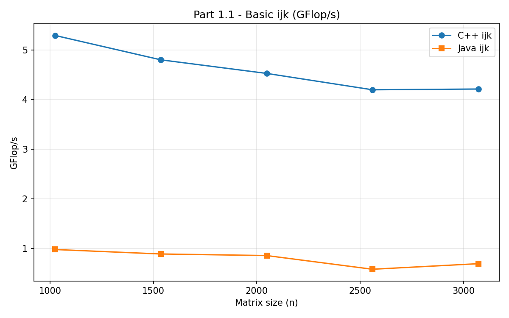
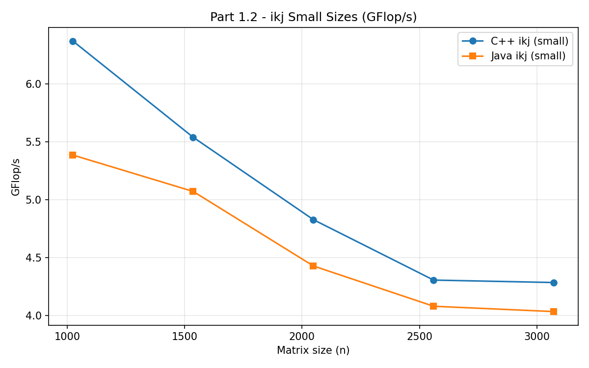
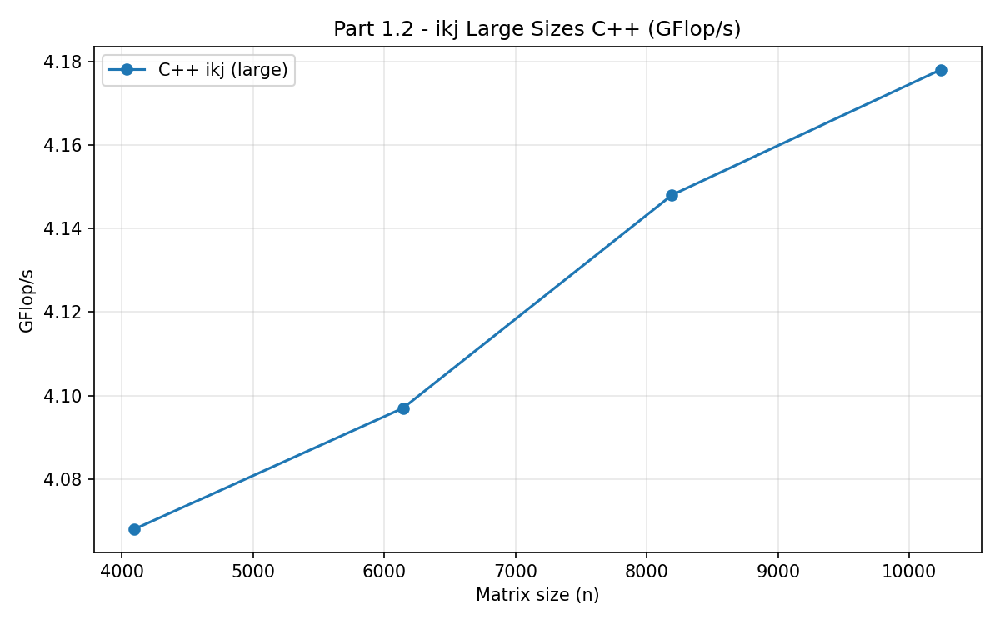
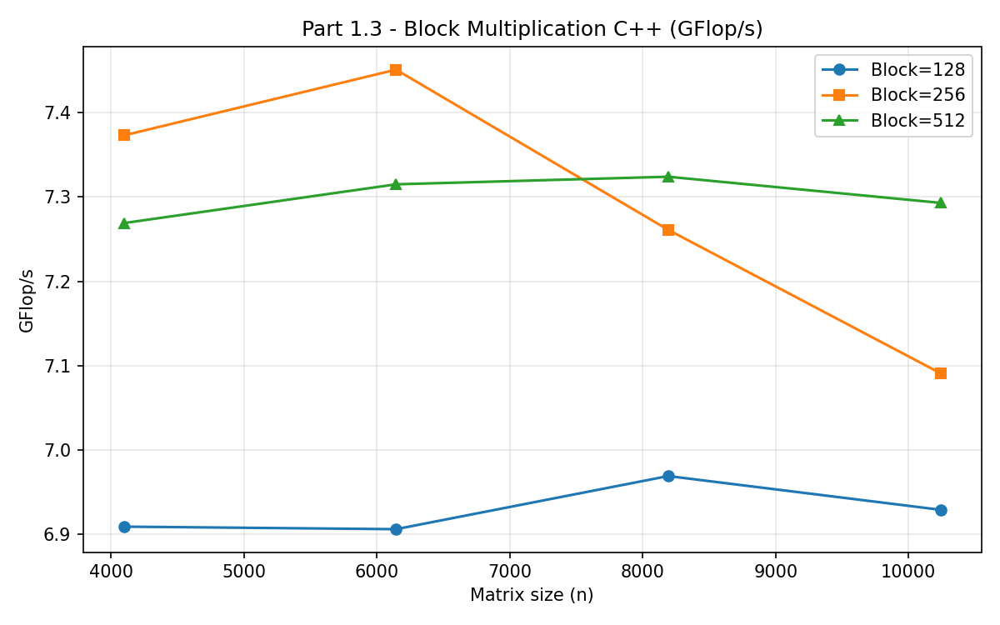
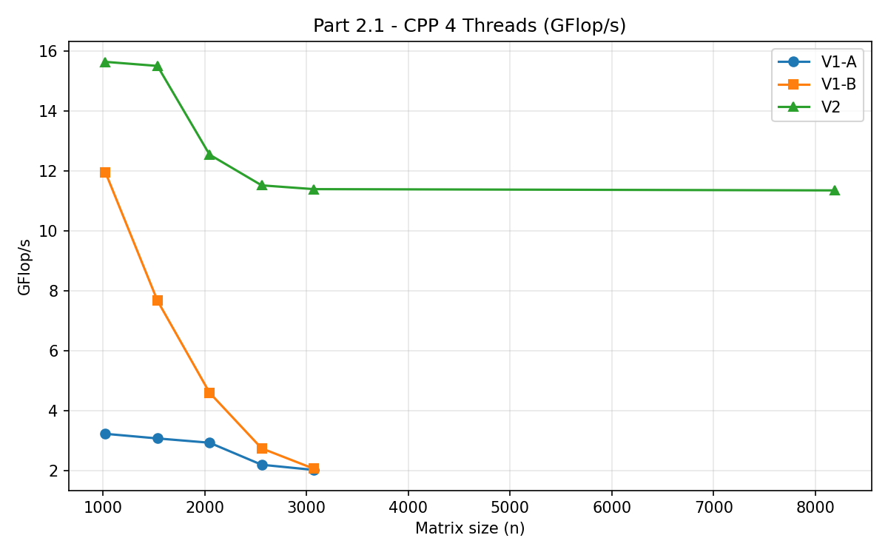
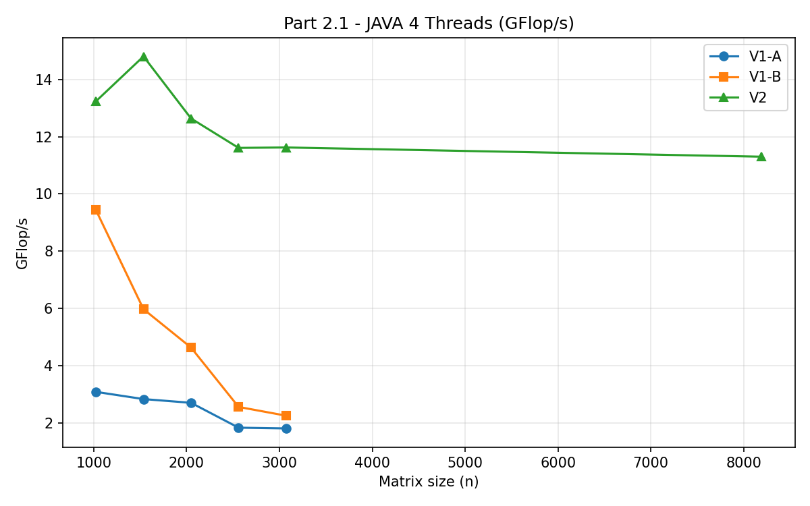
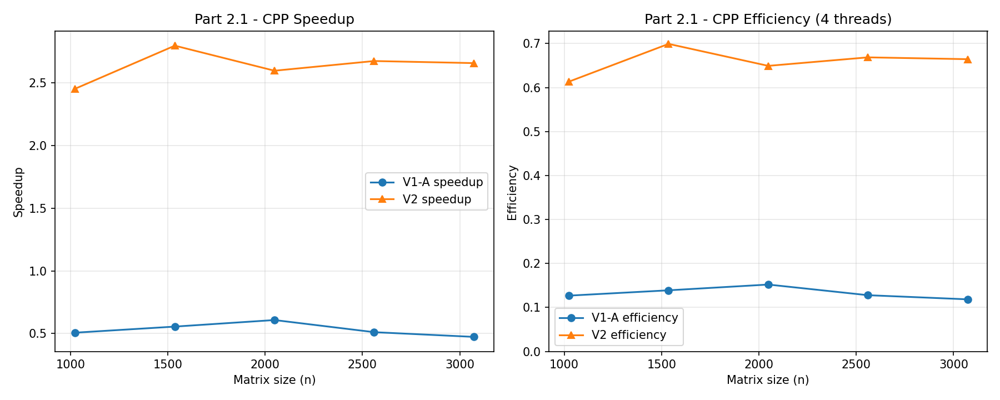
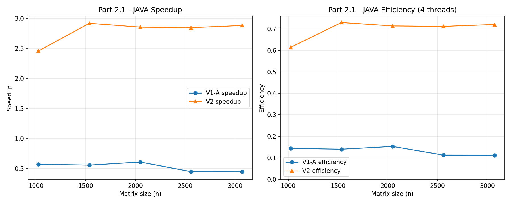
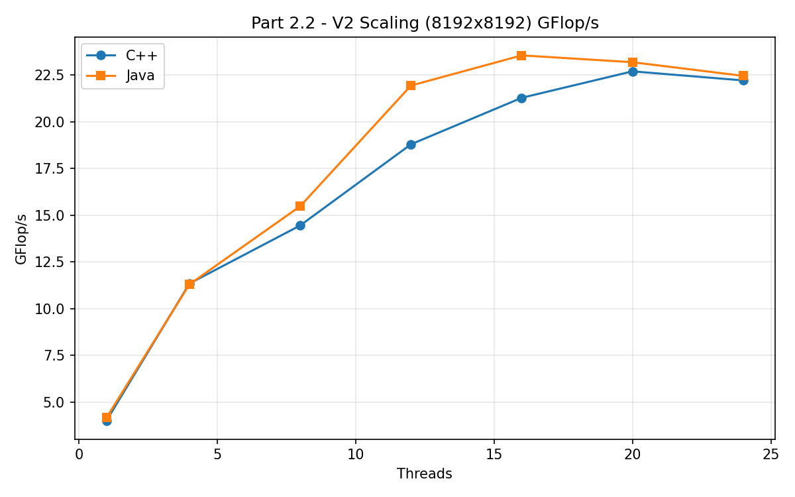
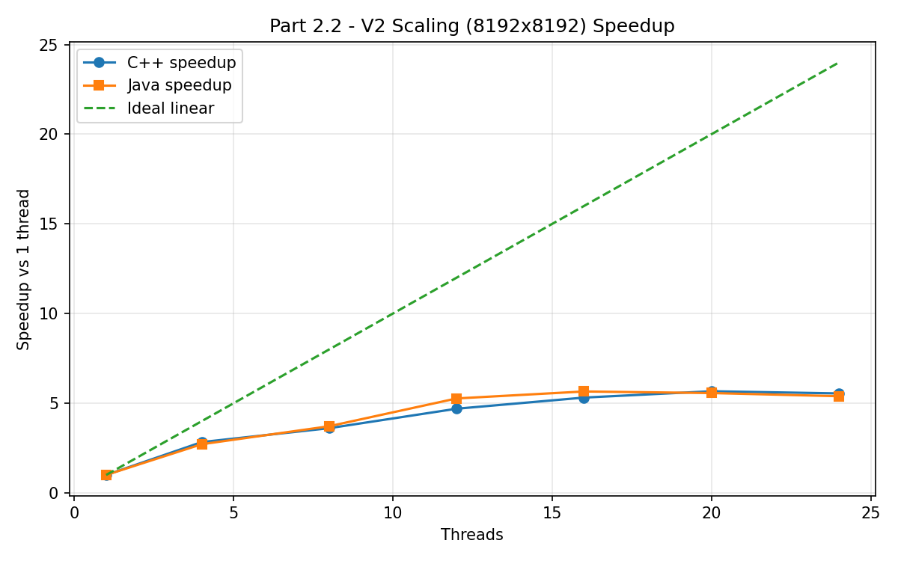

# CPD Project 1 — Performance Evaluation of Matrix Multiplication

**Course:** L.EIC – CPD | FEUP  
**Group:** T07G11  
**Members:**
- António Tavares (202008423),
- Francisco Bandeira (202208526), 
- José Reis (202307304)  

---

## Table of Contents

1. [Introduction](#introduction)
2. [Part 1 — Single-Core Performance Evaluation](#part-1--single-core-performance-evaluation)
   - [1.1 — Basic Matrix Multiplication (ijk)](#11--basic-matrix-multiplication-ijk)
   - [1.2 — Line (Cache-Friendly) Matrix Multiplication (ikj)](#12--line-cache-friendly-matrix-multiplication-ikj)
   - [1.3 — Block Matrix Multiplication](#13--block-matrix-multiplication)
   - [1.4 — Performance Counter Analysis with `perf`](#14--performance-counter-analysis-with-perf)
   - [1.5 — Conclusions (Part 1)](#15--conclusions-part-1)
3. [Part 2 — Multi-Core Performance Evaluation](#part-2--multi-core-performance-evaluation)
   - [2.1 — Parallel Versions of Version 1 (ijk) and Version 2 (ikj)](#21--parallel-versions-of-version-1-ijk-and-version-2-ikj)
   - [2.2 — Version 2 Scalability with Thread Count (8192×8192)](#22--version-2-scalability-with-thread-count-81928192)
   - [2.3 — Conclusions (Part 2)](#23--conclusions-part-2)
4. [Overall Conclusions](#overall-conclusions)

---

## Introduction

This report analyses the performance impact of the memory hierarchy and multi-core parallelism on matrix multiplication. Two implementations are compared — C/C++ and Java — using progressively more cache-friendly and parallelised algorithms. Performance is measured in GFlop/s (based on the computational complexity of 2n³ floating-point operations for an n×n matrix product) and supplemented with hardware performance counters collected via Linux `perf`.

---

## Part 1 — Single-Core Performance Evaluation

### 1.1 — Basic Matrix Multiplication (ijk)

**Description:**  
The standard triple-nested loop multiplying one row of matrix A by each column of matrix B (ijk order). This access pattern causes poor cache utilisation for matrix B due to column-wise access.

**Implementation notes:**
- C++ (`OnMult` in `mult.cpp`): Uses a transposed copy of B (`phbt`) to improve cache locality despite the ijk loop structure.
- Java (`onMult` in `Mult.java`): Direct ijk loop on row-major arrays.

**Tested matrix sizes:** 1024×1024, 1536×1536, 2048×2048, 2560×2560, 3072×3072

**Results:**

| Size | C++ Time (s) | C++ GFlop/s | Java Time (s) | Java GFlop/s |
|------|-------------|-------------|--------------|--------------|
| 1024 | 0.405 | 5.298 | 2.191 | 0.980 |
| 1536 | 1.508 | 4.806 | 8.141 | 0.890 |
| 2048 | 3.791 | 4.532 | 20.016 | 0.858 |
| 2560 | 7.984 | 4.202 | 57.610 | 0.582 |
| 3072 | 13.751 | 4.217 | 83.510 | 0.694 |

**Graph:**


**Analysis:**  
C++ achieves approximately 4.2–5.3 GFlop/s across the tested sizes, while Java delivers only 0.6–1.0 GFlop/s — a roughly 5× gap. The key reason is that the C++ implementation pre-transposes matrix B before the multiplication, converting the column-wise access pattern into sequential row access. This significantly reduces cache misses despite the ijk loop order. Java's implementation accesses B column by column in its original row-major layout, generating a cache miss on virtually every element of B touched. As matrix size grows and B no longer fits in cache, performance in Java degrades sharply (notably from 2048 to 2560). C++ performance also degrades with size but far more gradually because transposing B amortises the cache penalty across the computation.

---

### 1.2 — Line (Cache-Friendly) Matrix Multiplication (ikj)

**Description:**  
The loop order is reorganised to ikj, so that for each element `A[i][k]`, the entire row `k` of B is traversed sequentially. This dramatically improves spatial locality and cache hit rates.

**Implementation notes:**
- C++ (`OnMultLine` in `mult.cpp`): Caches `pha[iRow + k]` as `aik` and iterates sequentially across the j dimension.
- Java (`onMultLine` in `Mult.java`): Equivalent ikj loop structure on flat arrays.

**Tested matrix sizes (C++ and Java):** 1024×1024 to 3072×3072 (step 512)  
**Tested matrix sizes (C++ only):** 4096×4096 to 10240×10240 (step 2048)

**Results (small sizes — both languages):**

| Size | C++ Time (s) | C++ GFlop/s | Java Time (s) | Java GFlop/s |
|------|-------------|-------------|--------------|--------------|
| 1024 | 0.337 | 6.370 | 0.399 | 5.385 |
| 1536 | 1.308 | 5.539 | 1.429 | 5.071 |
| 2048 | 3.559 | 4.827 | 3.881 | 4.427 |
| 2560 | 7.794 | 4.305 | 8.226 | 4.079 |
| 3072 | 13.534 | 4.284 | 14.376 | 4.033 |

**Results (large sizes — C++ only):**

| Size | C++ Time (s) | C++ GFlop/s |
|------|-------------|-------------|
| 4096 | 33.783 | 4.068 |
| 6144 | 113.224 | 4.097 |
| 8192 | 265.079 | 4.148 |
| 10240 | 514.030 | 4.178 |

**Graph:**



**Analysis:**  
The ikj reordering produces a dramatic improvement for Java — from ~0.7–1.0 GFlop/s (ijk) to ~4.0–5.4 GFlop/s — nearly closing the gap with C++. Both languages now exhibit similar performance because both access B row by row, making effective use of cache lines loaded from memory. At smaller sizes (1024–1536), C++ still holds a modest edge (~6.4 vs ~5.4 GFlop/s), likely due to JVM overhead and JIT warm-up; as matrix size grows the two converge tightly. For large C++ sizes (4096–10240), performance remains remarkably stable around 4.0–4.2 GFlop/s, indicating that memory bandwidth, not cache capacity, is the dominant bottleneck for these sizes — the working set far exceeds L2/L3 cache but sequential access patterns maximise prefetcher efficiency.

---

### 1.3 — Block Matrix Multiplication

**Description:**  
Matrices are divided into sub-blocks of a configurable size. Computation follows the ikj order within each block, maximising data reuse within the cache before moving to the next block. Only implemented in C++ (`OnMultBlock` in `mult.cpp`).

**Tested matrix sizes:** 4096×4096 to 10240×10240 (step 2048)  
**Tested block sizes:** 128, 256, 512

**Results:**

| Size | Block=128 Time (s) | Block=128 GFlop/s | Block=256 Time (s) | Block=256 GFlop/s | Block=512 Time (s) | Block=512 GFlop/s |
|------|--------------------|--------------------|--------------------|--------------------|--------------------|--------------------|
| 4096 | 19.893 | 6.909 | 18.640 | 7.373 | 18.907 | 7.269 |
| 6144 | 67.167 | 6.906 | 62.250 | 7.451 | 63.414 | 7.315 |
| 8192 | 157.774 | 6.969 | 151.432 | 7.261 | 150.134 | 7.324 |
| 10240 | 309.924 | 6.929 | 302.836 | 7.091 | 294.440 | 7.293 |

**Graph:**


**Analysis:**  
Block multiplication consistently outperforms the plain ikj version by approximately 70% at these sizes (e.g. ~7.3 GFlop/s vs ~4.1 GFlop/s for 4096×4096). By working on sub-matrices small enough to reside in L2/L3 cache, the algorithm drastically reduces the number of main-memory accesses. Block size 256 gives the best or near-best results across all tested matrix sizes, making it the optimal choice on this hardware. Block size 128 is slightly worse, likely because the smaller blocks reduce reuse granularity and increase loop overhead. Block size 512 performs comparably to 256 at larger matrices but marginally worse at 4096 — at that size, 512-element blocks approach or exceed the L2 cache capacity, eroding the advantage. Performance is highly consistent across matrix sizes (6.9–7.5 GFlop/s regardless of n), confirming that blocking successfully decouples computation throughput from the total matrix footprint.

---

### 1.4 — Performance Counter Analysis with `perf`

**Description:**  
Linux `perf stat` was used to collect hardware performance counters for the three algorithm variants, focusing on L1 and L2 cache miss rates to validate the cache behaviour observed in execution times.

**Commands used:**
```bash
# General stats
perf stat ./multCPP

# Cache miss counters
perf stat -e cpu_core/mem_load_retired.l1_miss/,cpu_core/mem_load_retired.l2_miss/ ./multCPP

# [TODO: Add any additional counters explored, e.g. cache-references, instructions, cycles]
```

**Results (C++, matrix size 4096×4096):**
 
| Algorithm | L1 Misses | L2 Misses | IPC (core) | Backend Bound % | Retiring % |
|-----------|-----------|-----------|------------|-----------------|------------|
| ijk (transposed B) | 572,976,555 | 68,565,584 | 2.31 | 54.4% | 30.6% |
| ikj (line) | 5,516,968,490 | 562,573,095 | 3.05 | 39.2% | 43.1% |
| Block (block=256) | 5,472,243,009 | 25,630,098 | 4.68 | 26.2% | 65.2% |
 
**Results (Java, matrix size 4096×4096):**
 
| Algorithm | L1 Misses | L2 Misses | IPC (core) | Backend Bound % | Retiring % |
|-----------|-----------|-----------|------------|-----------------|------------|
| ijk | 67,187,367,080 | 64,042,731,983 | 0.55 | 87.1% | 9.4% |
| ikj (line) | 1,081,737,067 | 44,098,460 | 2.62 | 34.6% | 52.9% |
| Block (block=256) | 923,802,616 | 10,219,453 | 3.78 | 4.3% | 74.7% |

**Analysis:**  
The cache counter data strongly confirms the theoretical expectations.
 
For C++, the ijk version (with transposed B) has surprisingly few L1 misses (~573M) compared to ikj (~5.5B). This seems counterintuitive at first but makes sense: the transposed B ensures that both the i-loop iteration over A's row and the j-loop iteration over B_transposed's row are sequential; the total memory traffic is reduced because the transposition is a one-time cost. However, IPC is lower (2.31) and backend-bound stalls are higher (54.4%), indicating that even with transposition the access pattern creates some memory pressure. The ikj version generates more L1 misses because matrix A is read once per k-step across the entire j dimension — a less regular pattern relative to the transposed B approach for this size — but IPC improves (3.05), suggesting better instruction-level parallelism. Critically, the block version keeps L2 misses at just ~25.6M (vs ~563M for ikj), demonstrating that blocking successfully keeps the hot working set within L2 cache. The result is the highest IPC (4.68) and the lowest backend-bound fraction (26.2%), with 65.2% of cycles spent in productive Retiring — explaining why block multiplication is ~70% faster.
 
For Java, the ijk version suffers catastrophic cache behaviour: ~67B L1 misses and ~64B L2 misses at 4096×4096, meaning nearly every L1 miss cascades all the way to main memory. This explains the 87.1% backend-bound rate and near-zero IPC (0.55). The ikj reordering reduces L1 misses by 62× and L2 misses by 1450×, confirming that sequential access to B's rows is the critical fix. Java's block version reduces L2 misses a further 4× vs ikj, and the backend-bound fraction drops to just 4.3% with 74.7% retiring — making Java block multiplication effectively compute-bound, an impressive result.

---

### 1.5 — Conclusions (Part 1)

The experiments in Part 1 clearly demonstrate that memory access patterns, not raw compute throughput, dominate performance for matrix multiplication at the sizes tested.
 
**ijk vs ikj:** The loop reordering from ijk to ikj has a transformative effect in Java (~5.5× speedup) and a modest but measurable effect in C++ (~5–20% depending on size). The reason is straightforward: ijk access on an unmodified B matrix strides through memory column by column, generating a cache miss on nearly every element; ikj accesses B row-sequentially, maximising spatial locality and prefetcher effectiveness. C++'s transposed-B optimisation partially compensates in the ijk version, which is why the gap is smaller there.
 
**Effect of blocking:** Tiling with block size 256 yields a consistent ~70% throughput gain over plain ikj in C++ for large matrices. By ensuring that three sub-matrices (a block of A, a block of B, and the corresponding accumulator in C) fit in L2/L3 cache simultaneously, the algorithm converts expensive DRAM accesses into fast cache hits. The perf counters confirm this: L2 misses drop by 22× from ikj to block multiplication.
 
**C++ vs Java:** For ijk, C++ outperforms Java by ~5× due to the B-transposition optimisation and the absence of JVM overhead. For ikj and block, the gap narrows to under 10% for large sizes, showing that when access patterns are optimised, Java's JIT-compiled code approaches native performance for compute-intensive loops.
 
**perf counter confirmation:** The TMA breakdown consistently shows that backend-bound stalls (caused by memory latency) decrease monotonically as the algorithm improves cache behaviour — from 87% (Java ijk) down to 4.3% (Java block). Retiring fractions increase in the same direction, confirming that better cache utilisation allows the processor to execute useful work in a larger fraction of cycles.

---

## Part 2 — Multi-Core Performance Evaluation

### 2.1 — Parallel Versions of Version 1 (ijk) and Version 2 (ikj)

**Description:**  
Two parallel strategies are analysed for Version 1 (ijk) and the correct parallel approach is applied to Version 2 (ikj). All experiments use 4 threads and matrix sizes from 1024×1024 to 3072×3072 (step 512).

#### V1-A — `#pragma omp parallel for` on outer loop (ijk)

Parallelises the outermost `i` loop. Each thread handles a disjoint set of rows of C, so there are no data races. This is the correct parallel strategy for the ijk formulation.

```cpp
#pragma omp parallel for
for (int i = 0; i < n; i++)
    for (int j = 0; j < n; j++) {
        temp = 0;
        for (int k = 0; k < n; k++)
            temp += A(i,k) * B(k,j);
        C(i,j) = temp;
    }
```

#### V1-B — `#pragma omp parallel` + `#pragma omp for` on inner k loop (ijk)

Parallelises the innermost `k` loop. Introduces a race condition on `temp` and `C[i][j]` as multiple threads accumulate into the same element. Included for analysis purposes.

```cpp
#pragma omp parallel
for (int i = 0; i < n; i++)
    for (int j = 0; j < n; j++) {
        temp = 0;
        #pragma omp for
        for (int k = 0; k < n; k++)
            temp += A(i,k) * B(k,j);
        C(i,j) = temp;
    }
```

#### V2 — `#pragma omp parallel for` on outer loop (ikj)

Parallelises the outermost `i` loop of the cache-friendly ikj formulation. Combines good spatial locality with correct parallelism.

```cpp
#pragma omp parallel for
for (int i = 0; i < n; i++)
    for (int k = 0; k < n; k++)
        for (int j = 0; j < n; j++)
            C(i,j) += A(i,k) * B(k,j);
```

**Results — C++ (4 threads, matrix sizes 1024–3072, step 512):**

| Size | V1-A Time (s) | V1-A GFlop/s | V1-B Time (s) | V1-B GFlop/s | V2 Time (s) | V2 GFlop/s |
|------|--------------|--------------|--------------|--------------|------------|------------|
| 1024 | 0.664 | 3.233 | 0.180 | 11.956 | 0.137 | 15.629 |
| 1536 | 2.354 | 3.079 | 0.945 | 7.671 | 0.468 | 15.493 |
| 2048 | 5.851 | 2.936 | 3.732 | 4.604 | 1.370 | 12.537 |
| 2560 | 15.240 | 2.202 | 12.209 | 2.748 | 2.914 | 11.513 |
| 3072 | 28.558 | 2.030 | 27.995 | 2.071 | 5.092 | 11.387 |

**Results — Java (4 threads, matrix sizes 1024–3072, step 512):**

| Size | V1-A Time (s) | V1-A GFlop/s | V1-B Time (s) | V1-B GFlop/s | V2 Time (s) | V2 GFlop/s |
|------|--------------|--------------|--------------|--------------|------------|------------|
| 1024 | 0.696 | 3.085 | 0.228 | 9.435 | 0.162 | 13.238 |
| 1536 | 2.558 | 2.833 | 1.213 | 5.974 | 0.490 | 14.806 |
| 2048 | 6.357 | 2.703 | 3.708 | 4.633 | 1.360 | 12.637 |
| 2560 | 18.299 | 1.834 | 13.111 | 2.559 | 2.890 | 11.609 |
| 3072 | 32.074 | 1.808 | 25.740 | 2.253 | 4.988 | 11.624 |

**Speedup and Efficiency — C++ (relative to sequential ikj, 4 threads):**

| Size | V1-A Speedup | V1-A Efficiency | V2 Speedup | V2 Efficiency |
|------|-------------|-----------------|-----------|---------------|
| 1024 | 0.51 | 0.13 | 2.45 | 0.61 |
| 1536 | 0.56 | 0.14 | 2.80 | 0.70 |
| 2048 | 0.61 | 0.15 | 2.60 | 0.65 |
| 2560 | 0.51 | 0.13 | 2.67 | 0.67 |
| 3072 | 0.47 | 0.12 | 2.66 | 0.66 |

**Speedup and Efficiency — Java (relative to sequential ikj, 4 threads):**

| Size | V1-A Speedup | V1-A Efficiency | V2 Speedup | V2 Efficiency |
|------|-------------|-----------------|-----------|---------------|
| 1024 | 0.57 | 0.14 | 2.46 | 0.62 |
| 1536 | 0.56 | 0.14 | 2.92 | 0.73 |
| 2048 | 0.61 | 0.15 | 2.85 | 0.71 |
| 2560 | 0.45 | 0.11 | 2.85 | 0.71 |
| 3072 | 0.45 | 0.11 | 2.88 | 0.72 |

**Graphs:**





**Analysis:**
V1-B parallelises the innermost k loop using `#pragma omp for` inside a `#pragma omp parallel` region, while the outer i and j loops are replicated across all threads. This introduces a data race on the shared variable `temp`: multiple threads concurrently accumulate partial products into the same memory location without synchronisation, producing incorrect results. The GFlop/s values reported for V1-B are therefore not indicative of useful computation — the apparent throughput at small sizes (e.g. 11.96 GFlop/s at 1024 in C++) merely reflects that work completes quickly when partial sums are silently lost. As matrix size increases, V1-B performance degrades sharply (to ~2.1 GFlop/s at 3072), dominated by the cost of n² implicit barriers at the end of each `#pragma omp for` region and by cache line invalidation as all threads contend on the same `temp` and `C(i,j)` addresses.

V1-A correctly parallelises the outer i loop, assigning each thread a disjoint set of rows of C. However, the ijk loop order accesses matrix B column-wise (B(k,j)), which generates a cache miss on nearly every access. This cache penalty is severe enough that V1-A with 4 threads is consistently slower than the sequential ikj baseline, yielding speedups of 0.47–0.61 and efficiencies of 0.12–0.15. Parallelism alone cannot compensate for an access pattern that saturates the memory subsystem with random-stride requests.

V2 combines correct outer-loop parallelism with the cache-friendly ikj access pattern. Each thread processes a contiguous block of rows, and within each row the computation traverses B sequentially. The result is a speedup of 2.5–2.8× over the sequential ikj version (efficiency 0.61–0.72), the highest of the three strategies. The sub-linear scaling relative to the ideal 4× is consistent with memory bandwidth contention: four threads issuing sequential streams simultaneously approach the bandwidth ceiling of the memory subsystem. C++ and Java exhibit closely matched behaviour across all three variants, confirming that parallelisation characteristics are driven by access pattern and thread coordination rather than by language runtime differences.

---

### 2.2 — Version 2 Scalability with Thread Count (8192×8192)

**Description:**  
Version 2 (ikj, `#pragma omp parallel for` on outer loop) is executed on an 8192×8192 matrix with a varying number of threads: 4, 8, 12, 16, 20, 24. The goal is to analyse scalability and identify any performance saturation or degradation.

**Results — C++:**

| Threads | Time (s) | GFlop/s | Speedup (vs 1 thread) |
|---------|---------|---------|----------------------|
| 1 (baseline) | 274.712 | 4.002 | 1.00 |
| 4 | 96.918 | 11.345 | 2.83 |
| 8 | 76.098 | 14.449 | 3.61 |
| 12 | 58.518 | 18.789 | 4.69 |
| 16 | 51.680 | 21.276 | 5.32 |
| 20 | 48.453 | 22.692 | 5.67 |
| 24 | 49.514 | 22.206 | 5.55 |

**Results — Java:**

| Threads | Time (s) | GFlop/s | Speedup (vs 1 thread) |
|---------|---------|---------|----------------------|
| 1 (baseline) | 264.144 | 4.163 | 1.00 |
| 4 | 97.292 | 11.301 | 2.72 |
| 8 | 71.041 | 15.477 | 3.72 |
| 12 | 50.138 | 21.930 | 5.27 |
| 16 | 46.698 | 23.545 | 5.66 |
| 20 | 47.434 | 23.180 | 5.57 |
| 24 | 48.978 | 22.449 | 5.39 |

**Graphs:**



**Analysis:**
Both languages exhibit a characteristic sub-linear scaling curve that flattens beyond 16 threads. From 1 to 12 threads, throughput increases steadily — C++ reaches 18.8 GFlop/s (4.69× speedup) and Java reaches 21.9 GFlop/s (5.27× speedup). Beyond 12 threads, gains diminish rapidly: adding another 4 threads (to 16) yields only a modest improvement, and at 20–24 threads performance plateaus or slightly regresses.

The maximum observed speedup is approximately 5.7× in C++ (at 20 threads) and 5.7× in Java (at 16 threads), far below the ideal linear speedup of 20× or 16× respectively. This saturation is consistent with a memory-bandwidth-bound workload: the ikj multiplication on an 8192×8192 matrix requires streaming ~1.5 GB of data per pass through B, and once the aggregate memory bandwidth demanded by the active threads exceeds what the DRAM subsystem can deliver, additional threads yield no further benefit. The slight performance regression observed at 24 threads (C++: 22.2 GFlop/s, down from 22.7 at 20 threads; Java: 22.4 GFlop/s, down from 23.5 at 16 threads) is attributable to increased contention on shared memory controllers and higher thread scheduling overhead as thread count approaches or exceeds the physical core count of the system.

Java scales slightly better than C++ in the 8–16 thread range, reaching higher absolute GFlop/s at 12 and 16 threads. This may reflect differences in JVM thread scheduling or memory allocation patterns that interact more favourably with the hardware prefetcher at these thread counts. At the extremes (1 thread and 20+ threads), both languages converge to nearly identical throughput, reinforcing the conclusion that memory bandwidth is the binding constraint.

---

### 2.3 — Conclusions (Part 2)

The experiments in Part 2 demonstrate that effective parallelisation of matrix multiplication requires both correct thread coordination and cache-friendly memory access patterns.

**V1-A vs V1-B:** V1-A parallelises the outer i loop, producing correct results with no data races. V1-B parallelises the inner k loop, introducing a race condition on the accumulator variable `temp`. While V1-B appears to achieve high throughput at small sizes, the results it produces are incorrect. Even setting correctness aside, V1-B suffers from n² implicit barriers (one per (i,j) pair) and severe false-sharing overhead, causing its performance to degrade below that of V1-A at larger sizes. V1-B is therefore unsuitable as a parallelisation strategy for this algorithm.

**V1-A vs V2:** Both employ correct outer-loop parallelism, but V1-A uses the ijk loop order (column-wise access to B) while V2 uses ikj (row-wise access). The difference is decisive: V1-A with 4 threads is slower than the sequential ikj version (speedup < 1), whereas V2 achieves speedups of 2.5–2.9×. This result demonstrates that cache locality is a prerequisite for parallelism to be effective — distributing cache-hostile work across more cores merely multiplies the memory bottleneck.

**Scalability:** Version 2 scales well up to approximately 12–16 threads on an 8192×8192 matrix, beyond which throughput saturates at ~22–23 GFlop/s. The maximum observed speedup of ~5.7× (at 20 threads in C++, 16 threads in Java) falls well short of ideal linear scaling, indicating that the workload transitions from compute-bound to memory-bandwidth-bound as thread count increases. The slight performance regression at 24 threads reflects contention on shared memory controllers and scheduling overhead.

**C++ vs Java:** Both languages exhibit closely matched parallel performance across all experiments. At 4 threads, V2 achieves 11.3–15.6 GFlop/s in C++ and 11.3–14.8 GFlop/s in Java; at scale (8192×8192, 16 threads), Java marginally outperforms C++ (23.5 vs 21.3 GFlop/s). These results confirm that for compute-intensive, bandwidth-bound workloads with optimised access patterns, the JVM's JIT compiler produces code of comparable efficiency to ahead-of-time compiled C++.

---

## Overall Conclusions

This study examined two orthogonal axes of performance optimisation for dense matrix multiplication: memory access pattern (loop ordering and blocking) and multi-core parallelism (OpenMP threading). The results demonstrate that both axes interact multiplicatively — parallelism amplifies the throughput of cache-friendly algorithms and equally amplifies the penalties of cache-hostile ones.

**Memory hierarchy dominance:** The single-core experiments established that loop reordering from ijk to ikj yields up to a 5.5× improvement in Java and a measurable improvement in C++, solely by converting column-wise B accesses into sequential row accesses. Block tiling with block size 256 provides an additional ~70% gain over plain ikj for large matrices by keeping sub-matrices within L2/L3 cache. The performance counters confirm the mechanism: L2 misses drop by 22× from ikj to block multiplication in C++, and the backend-bound stall fraction decreases from 87% (Java ijk) to 4.3% (Java block).

**Parallelism as a multiplier:** The multi-core experiments showed that parallelising the cache-friendly ikj variant (V2) with 4 threads yields 11–16 GFlop/s — a 2.5–2.9× speedup over the sequential version. In contrast, parallelising the cache-hostile ijk variant (V1-A) actually decreases throughput relative to the sequential ikj baseline (speedup < 1). This result is significant: adding threads to a memory-bound algorithm does not improve performance; it worsens it by increasing contention on the memory subsystem.

**Scalability limits:** Thread scaling experiments on 8192×8192 matrices revealed that V2 throughput saturates at approximately 22–23 GFlop/s (around 16–20 threads), reaching a maximum speedup of ~5.7×. The saturation point corresponds to the aggregate memory bandwidth ceiling of the test hardware. Beyond this point, additional threads contribute only scheduling and synchronisation overhead.

**Best observed configuration:** Among the configurations tested, block multiplication (block size 256) on a single core delivered the highest per-core throughput (~7.4 GFlop/s), while parallel V2 at 16–20 threads delivered the highest absolute throughput (~23 GFlop/s). Combining blocking with multi-threading — though not explicitly benchmarked in this study — would be expected to yield further gains by reducing per-thread bandwidth demand.

**Language comparison:** C++ and Java converge in performance once access patterns are optimised. The gap narrows from ~5× (ijk, where C++ benefits from manual B transposition) to under 10% (ikj and parallel variants). This indicates that the JVM's JIT compiler generates competitive machine code for regular, compute-intensive loops, and that algorithmic choices dominate over language runtime characteristics for this class of workload.

---

*Report compiled for CPD Project 1 — FEUP, March 2026.*